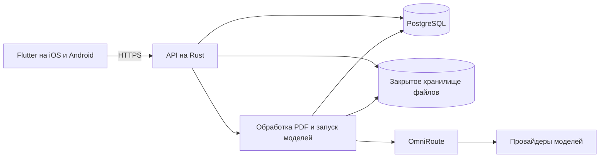

# Искра — техническое задание на мобильное приложение

**Версия 0.2 · Черновик для согласования · 9 ноября 2026**

«Искра» — мобильный ИИ-ассистент. Пользователь ведёт переписку, задаёт вопросы по файлам и получает помощь с кодом. История доступна на его устройствах. Приложение выбирает модель по задаче и предлагает ручной выбор из проверенного списка.

## 1. Решения перед запуском

| Решение | Рабочий вариант для черновика |
| --- | --- |
| Аудитория и доступ | Закрытая бета для 5 приглашённых пользователей, затем публичный запуск. Определить страны, языки и возраст аудитории перед публикацией. |
| Платформы | Flutter для Android и iOS. Русский интерфейс в бете. Утвердить очерёдность публикации. |
| Вход | Rust-сервер подтверждает email, создаёт аккаунт и выдаёт токен доступа. Выбрать сервис отправки писем. |
| Сервер | Новый Rust-бэкенд «Искры» на отдельном сервере с собственной PostgreSQL. Утвердить хостинг, постоянный домен API и регион хранения. |
| Оплата и нагрузка | Бесплатная бета с лимитами. Для публичной версии утвердить месячный бюджет, ожидаемое число пользователей и решение о подписке. |
| Хранение данных | История до удаления пользователем. Исходные вложения и их производные хранятся до 30 дней в бете. Утвердить срок хранения, регион и условия обработки данных провайдерами. |

Числа и настройки в таблице — предложения для беты. Для начала разработки интерфейса, истории и обработки вложений можно использовать эти значения как конфигурацию.

## 2. Сценарии и экраны

| Экран | Действия пользователя | Состояния |
| --- | --- | --- |
| Вход | Ввести email, подтвердить код, ознакомиться с обработкой данных. | Отправка кода, неверный или истёкший код, повторная отправка, потеря сети. |
| Новый чат и диалог | Написать сообщение, выбрать «Чат», «Агент» или «Код», выбрать модель, прикрепить файл. В ответе доступны копирование, остановка, повтор и жалоба на ответ. | Пустой чат, загрузка файла, очередь, поток ответа, частичный ответ, ошибка, достигнут лимит. |
| История | Открыть, переименовать или удалить чат. После входа на втором устройстве видеть ту же историю. | Пустой список, загрузка, устаревшая локальная копия, подтверждение удаления. |
| Просмотр вложения | Открыть PDF на странице, указанной в ответе. Увидеть состояние обработки или срок доступности файла. | Обработка, готово, ошибка чтения, файл удалён или срок хранения истёк. |
| Настройки | Посмотреть доступный лимит и время сброса, выбрать тему, выйти, запросить удаление аккаунта. | Лимит доступен, лимит исчерпан, подтверждение удаления. |

Главный экран следует макету «Искры». История и модель находятся в верхней панели. Внизу расположены режимы, кнопка «Прикрепить», поле сообщения и кнопка отправки. «Авто» показывает краткое описание выбора. После выполнения приложение отображает модель, которую вернул сервер. Для ручного выбора доступны фильтры «Все», «Код», «Изображения» и «Инструменты» по подтверждённым возможностям маршрута. Интерфейс учитывает системную тему, клавиатуру, крупный шрифт и подписи кнопок для экранного диктора.

### Регистрация и вход

Один экран подходит для первого и повторного входа. Пользователь вводит email и подтверждает одноразовый код. Бэкенд создаёт аккаунт только после подтверждения адреса. Во время закрытой беты регистрация доступна по списку приглашённых адресов. При повторном входе сервер открывает существующий аккаунт с его историей. Один и тот же подтверждённый адрес соответствует одному аккаунту с постоянным внутренним `account_id`.

Предложенные настройки беты — код действует 10 минут, используется один раз, доступно до 5 попыток проверки, повторная отправка через 60 секунд. Сервер ограничивает запросы по адресу и IP и отвечает одинаково для неизвестного и известного адреса на этапе запроса кода. Выход отзывает сессию устройства. Подтверждение удаления аккаунта требует свежей проверки личности. При удалении сервер закрывает все сессии и показывает состояние запроса.

После входа сервер «Искры» выдаёт уникальный случайный токен доступа для сессии пользователя. Клиент передаёт его в `Authorization: Bearer <access_token>`. У каждого устройства может быть своя сессия, и все сессии аккаунта используют одни и те же лимиты. При каждом запросе сервер находит аккаунт по токену и проверяет срок сессии, блокировку пользователя и права на ресурсы. Токен «Искры» используется для её API. Ключ OmniRoute остаётся на сервере.

Предлагаемые сроки для беты — токен доступа на 15 минут, токен обновления на 30 дней. Оба токена генерируются криптографическим генератором, а в PostgreSQL хранятся их хэши. Сервер заменяет токен обновления при использовании и отзывает сессии при выходе, блокировке и удалении. В базе отдельное ограничение уникальности для хэшей токенов.

### Чат

Пользователь отправляет текст и получает ответ по частям. Бэкенд хранит сообщения и подбирает контекст из текущего чата в пределах выбранной модели. Рендеринг поддерживает списки, ссылки и блоки кода с копированием. «Стоп» отменяет генерацию и сохраняет уже полученный текст с пометкой. При потере связи клиент восстанавливает состояние того же запроса. «Повторить» запускает новый ответ к существующему сообщению.

### Агент и вложения

Пользователь прикрепляет один PDF, PNG или JPEG и задаёт вопрос. Стартовые лимиты для беты — 10 МБ на файл и 20 страниц на PDF. Бэкенд проверяет формат, размер и права на файл. Он извлекает текст по страницам и переводит в изображения страницы со сканами или значимыми картинками, включая страницы, где есть и текст, и графика.

Текст отправляется вместе с номерами страниц. Для визуальных вопросов бэкенд передаёт подходящие изображения и текст модели с поддержкой изображений. Пользователь видит статусы «Читаю документ», «Ищу нужные страницы» и «Собираю ответ». В ответе можно открыть страницу-источник. Бэкенд проверяет, что указанные файл и страница относятся к этому запуску и доступны пользователю.

Первый инструмент агента `search_attachment` возвращает фрагменты и номера страниц только из вложений текущего чата. Бэкенд проверяет параметры и права, разрешает до трёх вызовов инструмента на запуск и прекращает выполнение при остановке. Содержимое файла и ответы инструмента обрабатываются как данные пользователя.

### Код

Пользователь вставляет код или сообщение об ошибке и получает объяснение, пример исправления или новый фрагмент. Ответ показывает язык и кнопку копирования. Выполнение кода и изменение репозитория относятся к будущим возможностям. Для режима «Код» нужно подтвердить хотя бы один маршрут на задачах Dart и Rust до включения в бете.

## 3. Модели и маршрутизация

| Назначение | Идентификатор OmniRoute | Основание |
| --- | --- | --- |
| «Авто» для текста, текстовый PDF | `openrouter/recursive/flint-v1.0:free` | Прошёл короткий потоковый тест на русском, вызов инструмента и извлечение данных из текста. |
| «Быстро» | `openrouter/liquid/lfm-3-1.7b:free` | Первый текст примерно за 1,2 с в одном коротком тесте. |
| Резерв для текстовых задач и агента | `openrouter/nvidia/nemotron-3-ultra-550b-a55b:free` | Прошёл текст, вызов инструмента и структурированный разбор примера. |
| Картинки и PDF со сканами | `openrouter/dots-studio/dots-3-note-preview:free` | Прошёл PNG и запрос с текстом одной страницы и изображением другой. |
| Резерв для отдельного изображения | `openrouter/nvidia/nemotron-3-nano-omni-30b-a3b-reasoning:free` | Прошёл PNG. Результат смешанного PDF не подтвердился. |
| Кандидат для «Кода» | `openrouter/cohere/north-mini-code:free` | Вызов инструмента проверен. Запрос с задачей на Dart вернул `429`, качество кода пока не измерено. |
| Ручной выбор и агент | `openrouter/nvidia/nemotron-3.5-super-vl:free` | Прошёл чат, вызов инструмента, разбор текста и чтение отрисованной страницы. Отдельный запрос с PNG достиг лимита длины ответа. |
| Ручной выбор | `openrouter/liquid/lfm-2.5-2.6b:free` | Прошёл чат и вызов инструмента. |
| Ручной выбор | `openrouter/google/gemma-4-31b-it:free` | Прошёл чат. Проверки инструмента и PNG завершились по таймауту. |
| Ручной выбор | `openrouter/nvidia/nemotron-3.5-lightning:free` | Прошёл чат и вызов инструмента. |

Всего в исходном прогоне девять маршрутов прошли короткий тест чата. Дополнительные модели можно открывать в ручном списке после проверки доступности. Результаты получены на коротких синтетических примерах. Для смешанного PDF использовался подготовленный запрос с текстом и изображением. При прямой отправке того же файла через Cloudflare-парсер в проверенных маршрутах извлекался только текстовый слой. [Обработка PDF в OpenRouter](https://openrouter.ai/docs/guides/overview/multimodal/pdfs)

Бэкенд отдаёт приложению собственные идентификаторы и список доступных моделей. Таблица маршрутов хранит имя, внешний идентификатор, проверенные возможности, статус и резерв для каждой задачи. «Авто» использует эту таблицу. В исходном прогоне одноимённый маршрут OmniRoute вернул `402`. Если маршрут «Авто» недоступен, сервер может один раз выбрать совместимый резерв до появления первого текста. При ручном выборе приложение предлагает сменить недоступную модель. После первого текста частичный результат сохраняется, и клиент предлагает повторить запрос.

## 4. Компоненты и API

Бэкенд на Rust управляет регистрацией, сессиями, историей, файлами и лимитами. Предлагаемые библиотеки — Axum для HTTP API, Tokio для асинхронных задач и SQLx для PostgreSQL и миграций. Воркеры обрабатывают PDF и отправляют запросы к OmniRoute. Файлы хранятся в закрытом S3-совместимом хранилище. [Axum](https://github.com/tokio-rs/axum) · [SQLx](https://github.com/transact-rs/sqlx)

Проект разделён на две папки верхнего уровня.

| Папка | Что в ней будет |
| --- | --- |
| [`server/`](server/README.md) | Cargo-проект. HTTP API, регистрация, сессии, квоты, работа с PostgreSQL, обработка PDF и клиент OmniRoute. Миграции в `server/migrations/`. |
| [`app/`](app/README.md) | Flutter-проект для iOS и Android. Экраны входа, чата, агента и настроек, защищённое хранение токенов сессии и клиент HTTPS API. |

В Flutter интерфейс отделён от состояния экрана и репозиториев, через которые идут сетевые запросы и синхронизация. [Архитектура Flutter](https://docs.flutter.dev/app-architecture/guide)

| API приложения | Назначение |
| --- | --- |
| `POST /v1/auth/email/request`, `POST /v1/auth/email/verify` | Отправить и проверить одноразовый код. После проверки Rust-сервер создаёт или открывает аккаунт и выдаёт пару токенов. |
| `POST /v1/auth/refresh`, `POST /v1/auth/logout` | Заменить токены сессии или отозвать её. |
| `GET /v1/models` | Доступные модели и их возможности. |
| `GET /v1/chats`, `POST /v1/chats`, `PATCH /v1/chats/{id}`, `DELETE /v1/chats/{id}` | История с пагинацией, создание, переименование и удаление. |
| `GET /v1/chats/{id}/messages` | Сообщения, состояния ответов и ссылки на источники. |
| `POST /v1/attachments`, `GET /v1/attachments/{id}` | Загрузка и состояние обработки файла. |
| `GET /v1/attachments/{id}/content` | Выдать файл владельцу или вернуть короткоживущую подписанную ссылку. |
| `POST /v1/chats/{id}/runs` | Создать запрос. Поля `requestId`, `mode`, `modelId`, `text`, `attachmentId`. Для повтора передаётся `retryOfRunId` с новым `requestId`. |
| `GET /v1/runs/{id}`, `GET /v1/runs/{id}/events` | Текущее состояние и поток событий SSE с последовательными номерами для восстановления соединения. |
| `POST /v1/runs/{id}/cancel` | Остановить выполнение. Повторная отмена возвращает текущее конечное состояние. |
| `POST /v1/messages/{id}/reports` | Отправить жалобу на ответ с категорией и необязательным комментарием. |
| `GET /v1/me/usage`, `POST /v1/me/deletion` | Остаток лимита и запрос на удаление аккаунта. |

Сервер проверяет сессию и владельца каждого ресурса. Создание сообщения и запуска идемпотентно по паре `userId` и `requestId`. Повтор с тем же идентификатором и тем же содержимым возвращает исходный запуск. Повтор с другим содержимым возвращает конфликт. События потока `status`, `delta`, `source`, `done`, `error` несут номер, `runId` и данные события. После разрыва клиент продолжает с последнего номера, а при истечении срока хранения событий загружает сохранённое состояние ответа. Состояния запуска — `queued`, `running`, `succeeded`, `failed`, `cancelled`.

Клиент получает собственные ошибки приложения, например `file_too_large`, `unsupported_file`, `limit_reached`, `model_unavailable`. `retryAfter` передаётся, когда сервер знает время следующей попытки. Для вызовов моделей сервер использует OpenAI-совместимый `/v1/chat/completions` OmniRoute. [API OmniRoute](https://omniroute.cheaperinference.com/api/)

Основные сущности — аккаунт и сессия, чат, сообщение, вложение, страница вложения, запуск, событие запуска, жалоба и запись использования. Запись использования связывает пользователя, запуск, фактическую модель и каждую попытку провайдера. Статус запуска и результат хранятся независимо от подключения телефона. После сбоя воркер возобновляет задачи из очереди. Для прерванного вызова с неизвестным результатом он сохраняет состояние и предлагает ручной повтор, чтобы избежать повторного вызова и списания.

| Таблица PostgreSQL | Назначение и ограничения |
| --- | --- |
| `accounts` | Внутренний `account_id`, уникальный подтверждённый email, роль и статус. |
| `sessions` | `account_id`, уникальные хэши токенов, сроки действия, время отзыва. |
| `account_limits` | Личные настройки квот. При создании аккаунта применяются настройки тарифа по умолчанию. |
| `account_usage_daily` | Уникальная пара `account_id` и дата UTC. Счётчики запросов и запросов с вложением. |
| `provider_usage_daily` | Отдельные счётчики вызовов и доступный бюджет по провайдеру. |
| `runs` | Запуски и ключ идемпотентности с ограничением уникальности по `account_id` и `request_id`. |

## 5. Лимиты, расходы и данные

- Бета — до 5 приглашённых пользователей, до 10 отправок и 3 отправок с вложением на человека в сутки, один активный запуск на аккаунт. Стартовый общий предел — 30 исходящих вызовов моделей в сутки. Лимиты редактируются на сервере. Пользователь видит остаток и время сброса в своём часовом поясе. Бета использует календарные сутки по UTC.
- Личные счётчики привязаны к `account_id`. Перевыпуск токена, новый телефон и повторный вход сохраняют использованный лимит. При исчерпании лимита сервер возвращает `429` с `limit_reached` и временем сброса. Провайдерский лимит и общий бюджет приложения учитываются отдельно.
- Отправка с вложением расходует единицу обоих пользовательских лимитов. Повтор доставки того же запроса по сети расходует лимит один раз. Новая генерация по кнопке «Повторить» расходует новую единицу. Попытки агента и резерва учитываются в общем пределе по отдельности. Rust-сервер выполняет проверку квоты, обновление счётчиков и постановку запуска в очередь в одной транзакции PostgreSQL. Перед каждым внешним вызовом воркер резервирует квоту провайдера. Отмена после отправки провайдеру сохраняет учёт этой попытки.
- Перед публичным запуском нужны подтверждённые квоты провайдеров и общий денежный предел. Бесплатные маршруты OpenRouter ограничены по частоте и суточному объёму. [Лимиты OpenRouter](https://openrouter.ai/collections/free-models/)
- Учёт различает известную цену, нулевую цену по тарифу и неизвестную цену. Маршрут с неизвестной ценой допускается в рамках денежного бюджета после настройки ставки или подтверждения нулевого тарифа. Уведомление «без настроенной цены» в OmniRoute показывает пробел в учёте. Тариф и списания сверяются с провайдером. [Цены в OmniRoute](https://github.com/cheaper-inference/OmniRoute/blob/main/docs/reference/API_REFERENCE.md#model-prices-pricing)
- В приложении хранится токен сессии «Искры» в защищённом хранилище устройства. Ключ OmniRoute находится в секретах бэкенда. В продакшене мобильный клиент подключается к постоянному HTTPS-адресу API приложения. Бэкенд обращается к OmniRoute по закрытому соединению. Выдача и проверка кодов входа ограничиваются по частоте.
- Бэкенд хранит вложения в закрытом хранилище. Журнал фиксирует идентификатор запроса, модель, статус, время, токены и стоимость при наличии. Текст переписок, файлы и ключи не попадают в операционные логи. При удалении чата удаляются связанные вложения и их производные. Удаление аккаунта отзывает сессии и запускает удаление пользовательских данных согласно опубликованным срокам.
- Для релиза нужны политика конфиденциальности, понятное объяснение передачи данных поставщикам ИИ и соответствующий запрос согласия, удаление аккаунта из приложения и веб-страница для запроса удаления в Google Play. Проверить условия обработки и публичного использования для каждого провайдера. [App Review Guidelines](https://developer.apple.com/app-store/review/guidelines/#privacy) · [Удаление аккаунтов в App Store](https://developer.apple.com/help/app-review/guideline-reference/5-1-1-account-deletion) · [Удаление аккаунтов в Google Play](https://support.google.com/googleplay/android-developer/answer/13327111)
- Жалобу на ответ можно подать из чата. Она появляется в панели владельца для разбора. Перед релизом определить правила обработки жалоб и фильтрации запрещённого контента. [Правила Google Play для ИИ-контента](https://support.google.com/googleplay/android-developer/answer/13985936)

## 6. Сервер и панель владельца

Rust API и обработчик PDF разворачиваются на отдельном сервере «Искры». PostgreSQL доступна сервисам «Искры» по закрытому соединению. Существующий OmniRoute остаётся отдельным шлюзом моделей, к которому Rust API обращается через приватную сеть или защищённый HTTPS. Сервис почты доставляет коды регистрации, а файлы хранятся в закрытом S3-совместимом хранилище. Публичный API «Искры» использует постоянный HTTPS-адрес, например `api.example.com`. Временный `trycloudflare.com` используется для проверок. [Назначение Quick Tunnels](https://developers.cloudflare.com/tunnel/get-started/quick-tunnels/)

Бета и публичная среда используют отдельные базы, хранилища и ключи. Доступ к базе, OmniRoute и панели владельца ограничен. На сервере нужны автоматические перезапуски сервисов, проверка состояния API, ежедневные резервные копии и проверка восстановления. Для релиза владелец должен определить, сколько времени допустимо восстанавливать сервис и сколько данных можно потерять при сбое.

Панель владельца «Искры» управляет пользователями приложения. Владелец может приглашать и блокировать пользователей, отзывать сессии, менять лимиты на пользователя и приложение, включать модели и назначать резерв. Панель показывает запросы, токены, остатки квот, ошибки провайдеров, расчётные расходы и жалобы. Доступ выделяется отдельной роли. Изменения лимитов, блокировки и переключения моделей записываются в журнал действий администратора.

Для первого развёртывания подготовить отдельный VPS или иной хостинг, домен и доступ к DNS, сервис отправки почты, собственную PostgreSQL, хранилище файлов и серверный ключ OmniRoute. Выбор ресурсов зависит от числа пользователей, доли запросов с PDF и утверждённого бюджета.

## 7. Приёмка и порядок реализации

| Этап | Когда готов |
| --- | --- |
| Регистрация и базовый чат | На Android и iOS можно впервые зарегистрироваться по приглашению, повторно войти без создания дубликата, отправить сообщение, получить поток, остановить его и открыть историю. Истёкший код не даёт войти. Повтор сетевого запроса не создаёт дубликат. |
| Токены, история и ограничения | Два аккаунта получают разные токены. Два устройства одного аккаунта видят общую историю и расходуют общий лимит, в том числе после обновления токена. Чужой чат или файл недоступен. Одновременные запросы не превышают квоту. |
| Вложения и агент | Текстовый PDF, скан, смешанный PDF, PNG и JPEG проходят проверку. Ответ на тестовый вопрос содержит точное значение и открывает правильную страницу. Повреждённый или слишком большой файл вызывает понятную ошибку. |
| Маршруты и код | Проверены отказы модели `401`, `402`, `429` и таймауты. Для включения «Кода» выбранная модель успешно проходит проверку на Dart и Rust с запуском изолированных тестов. |
| Закрытая бета | Есть отдельные тестовые секреты, сборки обоих клиентов, журнал ошибок, мониторинг квот, резервное копирование и проверка восстановления. Владелец может изменить лимит, выключить модель и обработать жалобу. Бюджетные лимиты действуют до подключения участников. |
| Публичный релиз | Утверждены бюджет, квоты, регионы и политика данных. Проверены удаление аккаунта, релизные сборки и восстановление после потери связи. Подготовлены материалы и учётные записи магазинов. |

Голос, поиск в интернете, генерация изображений и подключение внешних сервисов можно оценить отдельными этапами после беты.
